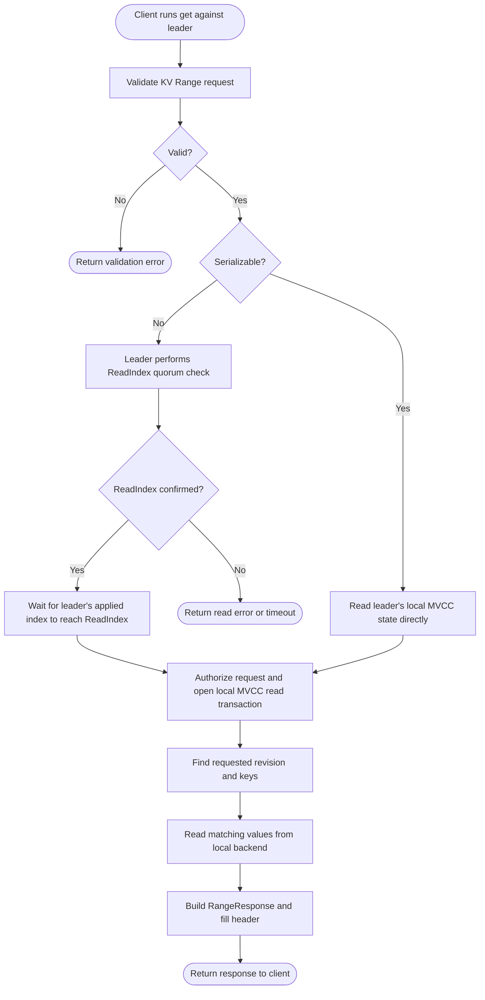
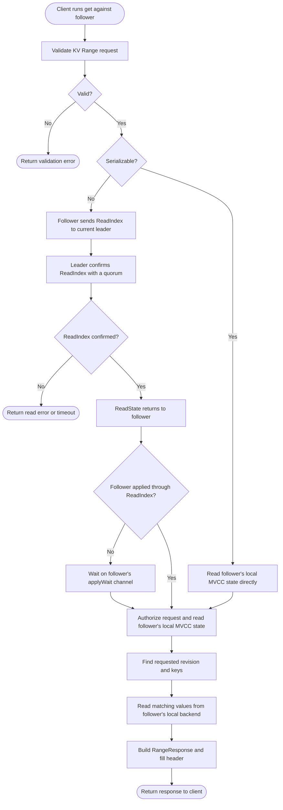

## Client connects to the leader

## Client connects to a follower

## What each step does

1. **Client runs `etcdctl get`.** The CLI sends a KV `Range` RPC. A single
   key lookup is represented by a range whose start key is the requested key.
2. **gRPC handler validates.** `kvServer.Range` checks the Range request
   fields, then delegates to `EtcdServer.Range`.
3. **Choose read consistency.** By default, etcd uses a linearizable read.
   If the request sets `Serializable`, etcd skips Raft read agreement and
   reads the contacted member's local state, which can be stale.
4. **Signal the linearizable read loop.** The request sends a signal on
   `waitC` and waits for the current read notifier. Multiple requests can be
   served by one read-index round.
5. **Ask Raft for a safe read index.** If the contacted member is the leader,
   it confirms the ReadIndex with a quorum itself. If the contacted member is a
   follower, its Raft node forwards the ReadIndex request to the leader. The
   leader confirms with a quorum and sends the resulting `ReadState` back to
   the requesting member.
6. **Wait until that index is applied.** A confirmed index can be ahead of the
   local state machine. The read loop waits until etcd has applied through
   that index before releasing the waiting Range requests.
7. **Handle read agreement errors.** A leader change, timeout, canceled
   request, or server shutdown can stop the linearizable-read wait and return
   an error.
8. **Check authorization.** The server checks that the caller may read the
   requested key or key range. It also checks that the auth revision did not
   change while the request was being handled.
9. **Open an MVCC read transaction.** The transaction gives the read a
   consistent view while it selects key versions.
10. **Resolve the revision.** An explicit request revision is used when
    provided. Revision `0` means the latest revision visible to this read.
    A future or compacted revision returns an error.
11. **Find matching keys.** MVCC uses its in-memory index to find the key
    revisions that match the requested key or range.
12. **Read values from the backend.** For each matching revision, MVCC reads
    and decodes the stored key/value record from the backend.
13. **Build the response.** etcd applies requested filtering and sorting,
    assembles the `RangeResponse`, and fills its response header before
    returning it through gRPC to the client.

## Channels used in this path

| Channel | What it carries or signals | Role in a Get |
| --- | --- | --- |
| `waitC` | A coalesced signal that one or more linearizable reads are waiting | Wakes the background linearizable-read loop. It has capacity one, so several waiting reads can share a read-index round. |
| `notifier.c` | A closed-channel notification, plus an error stored in the notifier | The Range request waits on this channel until the read loop has confirmed a read index and local apply has caught up, or until it reports an error. Closing it wakes all reads using that notifier. |
| `raft.ReadState()` / `readStateC` | Raft's confirmed read index and request context | Delivers Raft's ReadIndex confirmation to the read loop. `readStateC` is the etcd raft-node channel that carries these states. |
| `applyWait.Wait(index)` channel | Notification that etcd's applied index has advanced | If the confirmed read index is ahead of the local applied index, the read loop waits here before allowing the read to proceed. |
| `ctx.Done()` | Caller cancellation or request deadline | Stops the request while it waits for linearizable read agreement. |
| `LeaderChanged()`, `Stopping()`, and `Done()` channels | Leadership changes or server lifecycle signals | Allow the read loop or waiting RPC to stop/retry when leadership changes or the server shuts down. |

The Get path does **not** use the Put waiter channel or `applyc`: a Get does
not propose a write. Its linearizable coordination uses the read-index and
apply-wait channels, then reads MVCC state locally.

ReadIndex messages travel between members over the Raft peer transport. The
leader's quorum confirmation is a Raft protocol exchange; the Go `readStateC`
channel carries the resulting confirmation from the local Raft node to the
local read loop. See [`api/rafthttp`](../etcdserver/api/rafthttp).

## Leader and follower behavior

Each member has its own Raft node and MVCC/backend replica. Both charts show
that the key/value is always read from the contacted member's local store. A
linearizable read from a follower first gets a quorum-confirmed ReadIndex from
the leader, then waits for the follower's local state to catch up. The follower
does not fetch the key's value from the leader. A serializable read from either
member skips the quorum check and can see an older revision. In a one-member
cluster, the leader itself satisfies the quorum. See
[Lesson 13: Raft in this project](./13-raft-in-this-project.md).

A serializable Get skips that quorum check and reads the contacted member's
local state immediately. It can return an older revision while that member is
catching up. See [Lesson 13: Raft in this project](./13-raft-in-this-project.md).

## Code locations

- gRPC Range validation and delegation: [`api/v3rpc/key.go`](../etcdserver/api/v3rpc/key.go)
- Linearizable/serializable choice and authorization: [`v3_server.go`](../etcdserver/v3_server.go)
- Read-index loop and channels: [`read/read.go`](../etcdserver/read/read.go)
- ReadState and apply-wait signaling: [`raft.go`](../etcdserver/raft.go) and [`server.go`](../etcdserver/server.go)
- Range selection and response assembly: [`txn/range.go`](../etcdserver/txn/range.go)
- MVCC index and backend reads: [`kvstore_txn.go`](../storage/mvcc/kvstore_txn.go)
