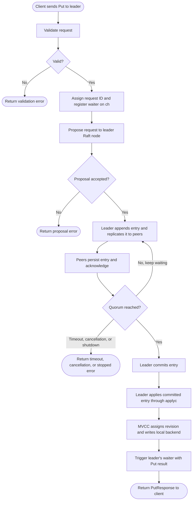
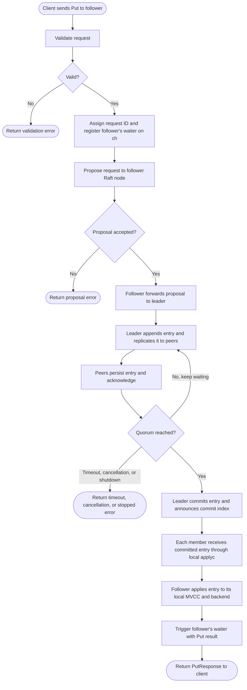

## Client connects to the leader

## Client connects to a follower

## What each step does

1. **Client sends Put.** The client sends the key and value using the etcd KV
   gRPC service. In the log example, these are `lesson` and `hello`.
2. **gRPC handler validates.** `kvServer.Put` checks the request and forwards
   it to the embedded `EtcdServer` implementation.
3. **EtcdServer prepares the operation.** `EtcdServer.Put` wraps the Put in an
   internal Raft request. The request is serialized so Raft can replicate it.
4. **Assign request ID.** The server gives the operation a unique ID. The ID
   lets the apply path match the committed operation to the client still
   waiting for its response.
5. **Register waiter.** `s.w.Register(id)` creates a result channel and stores
   it under the request ID before the proposal is sent. Registering first
   avoids a fast apply result arriving before the waiter exists.
6. **Propose to the local Raft node.** The RPC submits the request to the Raft
   node in the member it contacted. If that member is a follower, Raft forwards
   the proposal to the current leader over the peer transport. The original
   member keeps the request waiter open.
7. **Replicate to peers.** The leader appends the operation to its log and
   sends it to the other members. Each reachable follower persists the entry
   and acknowledges the leader.
8. **Commit with a quorum.** The leader commits the entry after a majority of
   cluster members have accepted it. A 3-member cluster needs 2 members; a
   5-member cluster needs 3. In a one-member cluster, the leader itself is the
   quorum. Without a quorum, the entry cannot commit and the waiting RPC can
   time out.
9. **Apply on members.** Each member applies the committed entry in Raft order
   to its own MVCC state and backend. The member that received the client
   request triggers that request's local waiter after applying the entry.
10. **Decode and dispatch.** The apply code decodes the Raft entry, finds the
    Put operation, and dispatches it through the applier chain.
11. **Update MVCC.** MVCC assigns the write a revision, updates the key index,
    and creates the versioned key/value record.
12. **Write backend data.** The MVCC transaction commits its changes to the
    backend. The write is now reflected in etcd's local storage state.
13. **Build apply result.** The applier constructs the Put response and
    result, including the response header.
14. **Wake the waiter.** The apply path calls `s.w.Trigger(id, result)`. This
    sends the result to the channel registered for that ID and closes it.
15. **Finish the RPC.** `processInternalRaftRequestOnce` selects on the result
    channel, request context cancellation/timeout, and server shutdown. On a
    result, it returns the Put response through the gRPC handler to the client.

Both charts show validation and proposal errors, plus timeout while waiting
for quorum. Cancellation and server shutdown also stop the pending request;
`cctx.Done()` and `s.done` are explained in the channel table.

Each etcd member runs its own Raft node and local MVCC/backend state. The two
charts show that a leader applies its own committed entry, while a follower
forwards the proposal and returns only after applying the committed entry
locally. See
[Lesson 13: Raft in this project](./13-raft-in-this-project.md).

## Channels used in this path

| Channel | What it carries or signals | Role in a Put |
| --- | --- | --- |
| `raftNode.applyc` (`chan toApply`) | A batch containing committed Raft entries and related apply metadata | Moves committed work from the Raft Ready loop to the etcd server apply loop. It does not carry the client response. |
| Waiter channel `ch` (`<-chan any`) | The apply result associated with one request ID | Connects the apply result back to the RPC goroutine that proposed that request. `Register` creates it; `Trigger` sends the result and closes it. |
| `cctx.Done()` | Request context cancellation or the configured request timeout | Lets the RPC stop waiting when its deadline expires or its caller cancels. |
| `s.done` | Server shutdown signal | Lets the RPC stop waiting when etcd shuts down. |
| `notifyc` in `toApply` | A synchronization signal from the Raft loop | Coordinates apply and Raft storage persistence, including safe snapshot work. It is not the Put response channel. |
| `raftAdvancedC` in `toApply` | A signal that Raft's applied index advanced | Used for configuration-change coordination; ordinary Put response delivery uses the waiter channel instead. |

The main response path is **request ID -> waiter channel -> `Trigger` -> RPC
select**. `applyc` is a separate channel that carries committed work to the
apply loop.

Between members, Raft uses the peer transport rather than these Go channels:
`MsgProp` carries a follower's proposal toward the leader, `MsgApp` carries
log entries and commit information from the leader to peers, and `MsgAppResp`
acknowledges replication progress. See [`api/rafthttp`](../etcdserver/api/rafthttp)
for etcd's Raft peer transport.

## Code locations

- RPC validation and delegation: [`api/v3rpc/key.go`](../etcdserver/api/v3rpc/key.go)
- Request ID, waiter registration, proposal, and result wait: [`v3_server.go`](../etcdserver/v3_server.go)
- Raft-to-apply `applyc` handoff: [`raft.go`](../etcdserver/raft.go)
- Apply loop and waiter trigger: [`server.go`](../etcdserver/server.go)
- Waiter channel implementation: [`pkg/wait/wait.go`](../../pkg/wait/wait.go)
- Put dispatch to MVCC: [`apply/backend.go`](../etcdserver/apply/backend.go)
- MVCC key version and revision write: [`kvstore_txn.go`](../storage/mvcc/kvstore_txn.go)
