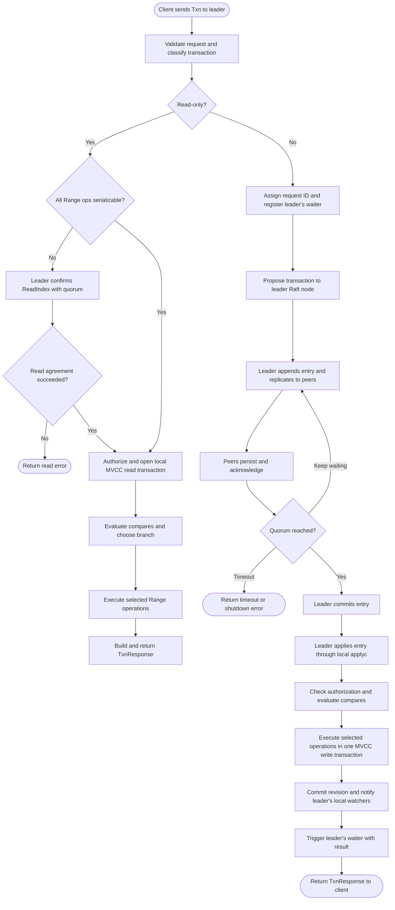
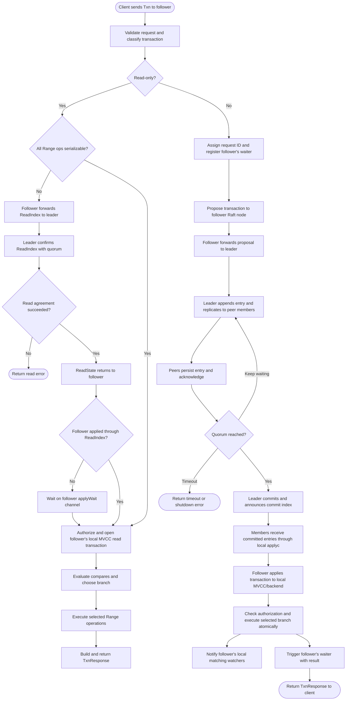

## Client connects to the leader

## Client connects to a follower

## What each step does

1. **Client sends a transaction.** A Txn request contains comparisons and two
   operation lists: `Success` and `Failure`. The server executes one list
   based on the comparisons.
2. **gRPC handler validates.** `kvServer.Txn` validates the request shape,
   operation count, and conflicting key ranges before delegating.
3. **Classify the transaction.** etcd treats a transaction containing only
   Range operations as read-only. A transaction containing a Put, Delete, or
   nested transaction follows the write path through Raft.
4. **Read-only consistency choice.** A read-only transaction waits for
   linearizable read agreement unless every Range in both branches requests
   serializable reads. Serializable reads skip Raft agreement and may read
   stale local state.
5. **Check authorization.** etcd checks permissions for the comparisons and
   operations in both branches before executing the transaction, including
   nested transactions.
6. **Open an MVCC read transaction.** The read view gives comparisons and
   Range operations a consistent revision to inspect.
7. **Evaluate comparisons.** etcd evaluates the compares and chooses either
   `Success` or `Failure`. A failed compare is a normal transaction outcome,
   not an RPC error.
8. **Execute selected read operations.** For a read-only transaction, etcd
   executes the chosen Range operations and builds a response. No Raft write
   proposal is needed.
9. **Register a waiter for a write transaction.** The server assigns a
   request ID and creates a result channel before proposing the operation.
   This lets the apply path return its result to this RPC.
10. **Propose and commit.** The contacted member sends the transaction to its
    local Raft node. A follower forwards it to the leader. The leader appends
    and replicates the entry; it commits after a majority has acknowledged it.
    For example, 3 members need 2 acknowledgments and 5 members need 3. A
    one-member cluster meets quorum locally. If quorum is unavailable, the
    caller can time out.
11. **Deliver committed work to apply.** Every member receives committed
    entries through its local `applyc` and applies them in the same order.
    The member contacted by the client applies the transaction locally before
    waking that RPC's waiter.
12. **Decode and authorize.** The apply path decodes the request and checks
    transaction permissions before dispatching it to the transaction applier.
13. **Evaluate compares and select a branch.** The write transaction compares
    against the MVCC view, then selects `Success` or `Failure`.
14. **Run operations in order.** The selected operations share one MVCC write
    transaction. Put, Delete, and Range results are placed in their matching
    positions in the Txn response. Nested transactions recurse through the
    same execution path.
15. **End the MVCC write transaction.** Changes become visible together at
    the transaction's revision. Readers do not see intermediate operations.
16. **Create watch events.** When the write transaction ends, MVCC turns its
    changes into Put/Delete events and notifies matching watchers.
17. **Return the write result.** The apply path triggers the request's
    waiter. The waiting RPC receives the result and returns the TxnResponse.

## Channels used in this path

| Channel | What it carries or signals | Role in a transaction |
| --- | --- | --- |
| Read `waitC` and notifier channel | A request for linearizable read agreement and its completion/error | Used for read-only transactions that are not fully serializable. See [`get-request-flow-diagram.md`](./get-request-flow-diagram.md) for the read-index steps. |
| `raftNode.applyc` (`chan toApply`) | Batches of committed Raft entries | Carries write transactions from the Raft loop to the apply loop. |
| Write waiter channel `ch` (`<-chan any`) | The apply result associated with the transaction request ID | Connects the committed transaction's result to the RPC waiting for it. `Register` creates it and `Trigger` delivers the result. |
| `cctx.Done()` | Caller cancellation or request deadline | Ends the RPC's wait for a write transaction result. |
| `s.done` | Server shutdown signal | Ends the RPC's wait if etcd shuts down. |
| Watch stream channel | MVCC watch responses containing events | Receives notifications produced when a write transaction ends. This channel serves watchers; it does not carry the TxnResponse. |

The transaction response and watch events use separate channels. The write
waiter returns the transaction result to its caller; MVCC's watch stream
channel delivers events to clients watching the changed keys.

For a write transaction, the peer transport carries proposal forwarding and
replication: `MsgProp` forwards a follower's proposal to the leader, `MsgApp`
replicates log entries and commit information, and `MsgAppResp` acknowledges
replication progress. These are Raft messages between members, separate from
the Go waiter and `applyc` channels. See
[`api/rafthttp`](../etcdserver/api/rafthttp).

Each etcd member runs an independent Raft node and local MVCC/backend replica.
The two charts show that write transactions are ordered by the leader and
committed by quorum, while read-only transactions use ReadIndex unless all
Range operations are marked serializable. See
[Lesson 13: Raft in this project](./13-raft-in-this-project.md).

## Code locations

- gRPC validation and delegation: [`api/v3rpc/key.go`](../etcdserver/api/v3rpc/key.go)
- Read-only/write classification and proposal path: [`v3_server.go`](../etcdserver/v3_server.go)
- Compare evaluation, branch selection, and operation execution: [`txn/txn.go`](../etcdserver/txn/txn.go)
- Raft request waiter and apply handoff: [`v3_server.go`](../etcdserver/v3_server.go), [`raft.go`](../etcdserver/raft.go), and [`server.go`](../etcdserver/server.go)
- Transaction applier and authorization: [`apply/auth.go`](../etcdserver/apply/auth.go) and [`apply/backend.go`](../etcdserver/apply/backend.go)
- MVCC write completion and watch notification: [`watchable_store_txn.go`](../storage/mvcc/watchable_store_txn.go)
