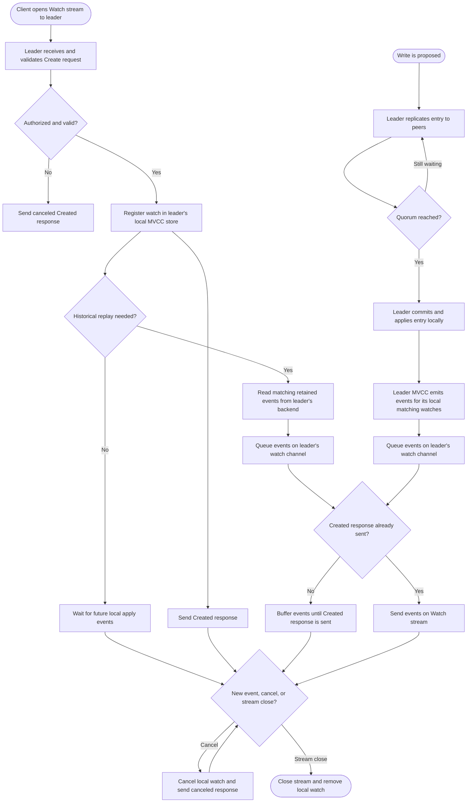
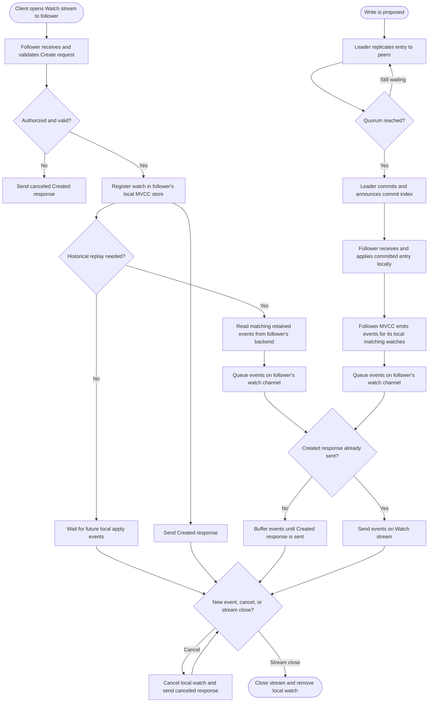

## Watch stream is served by the leader

## Watch stream is served by a follower

## What each step does

1. **Client opens the Watch stream.** The client opens the bidirectional KV
   Watch RPC. The stream stays open so the client can send watch commands and
   receive responses over time.
2. **Start receive and send loops.** The server runs one goroutine to read
   client requests and another to send responses. The loops share control and
   event channels.
3. **Receive a Create request.** The client asks to watch one key or a key
   range, optionally from a start revision, with filters and options such as
   previous values or progress notifications.
4. **Validate and authorize.** The receive loop normalizes the key range and
   checks that the caller may read it. Invalid or unauthorized watches get a
   canceled Created response with a reason.
5. **Register the watcher in MVCC.** `watchStream.Watch` allocates or accepts
   a watch ID and registers the key range, start revision, and filters.
6. **Choose catch-up or live mode.** A watcher whose nonzero start revision is
   at or behind the store revision is unsynced and needs historical events. A
   watcher starting after the current revision, or one that starts at
   revision zero, can be synced for future events.
7. **Catch up historical events when needed.** The MVCC sync loop reads
   retained revisions from the backend, selects matching events, and queues
   them for the watcher. If the requested revision was compacted, the watch
   is canceled with the compact revision.
8. **Acknowledge creation.** The receive loop queues a Created response on
   `ctrlStream`. The send loop sends it to the client. Events can arrive
   before this acknowledgment is sent, so the send loop buffers them by watch
   ID and flushes them after Created.
9. **Publish events from writes.** When a Put or write transaction ends,
   `watchableStoreTxnWrite.End` creates Put/Delete events. Every member does
   this when its local apply loop applies the committed write, and matches
   events against its own synced watchers and filters.
10. **Queue or retry delivery.** The store sends matching responses to the
    watch stream's buffered event channel. If that channel is full, it tracks
    the watcher as a slow victim and retries delivery instead of dropping the
    event.
11. **Prepare and send each response.** The send loop reads event responses,
    optionally fetches `PrevKv`, splits oversized responses when fragmentation
    is enabled, and calls gRPC `Send`.
12. **Handle control commands.** A Cancel request removes the watcher and
    queues a canceled response. A Progress request asks MVCC to send a
    progress notification. Periodic progress notifications are also requested
    for watches that enabled them.
13. **Close the stream.** When the client cancels or the stream errors, the
    server signals its loops to stop, closes the MVCC watch stream, and
    cancels its registered watchers.

## Channels used in this path

| Channel | What it carries or signals | Role in a Watch |
| --- | --- | --- |
| `watchStream.Chan()` / watcher `ch` | MVCC `WatchResponse` values, including event batches | Main event path from MVCC to the gRPC send loop. Each watch stream has a buffered channel shared by its watchers; this checkout sets its capacity to 128. |
| `ctrlStream` | Created, canceled, and other control responses | Keeps the receive loop from blocking while control responses are serialized and sent by the send loop. Its capacity is 16 in this checkout. |
| `closec` | Server-side stream close signal | Stops the send loop and unblocks receive-loop sends when the stream closes. |
| `errc` | Error returned by the receive goroutine | Reports receive-loop completion or failure to the Watch handler so it can close the stream. It is buffered for one error. |
| `stream.Context().Done()` | Client cancellation or gRPC stream termination | Ends the server-side Watch call and starts cleanup. |
| MVCC `victimc` | Signal that one or more watcher sends could not fit in the event channel | Wakes the MVCC retry loop to retry slow watchers' queued responses. The event is retained for retry. |
| Progress ticker channel | Periodic timer notifications | Lets the send loop request progress responses for watches with progress notifications enabled. |

The client and server exchange Watch RPC messages through gRPC `Recv` and
`Send`; those are stream operations, not Go channels. The Go channels above
coordinate the server's receive/send goroutines and MVCC event delivery.

## Multiple Raft members

Each etcd member has its own Raft node, MVCC/backend replica, and local set of
watch registrations. Creating a Watch does not add a watch entry to the Raft
log or replicate that registration to peers. The two charts show a stream
served by the leader or by a follower.

When a Put or write transaction commits, Raft replicates the log entry and
each available member applies it in the same order. Each member's local MVCC
store generates events and sends them only to matching watches on that member.
A client watching through the leader receives the leader's locally generated
events. A client watching through a follower receives that follower's events,
which can arrive later while it catches up. The members have separate watcher
registrations and channels.

If the client reconnects to another member, it must create the watch there
again. A start revision lets the new member replay retained events from its
local backend; if compaction has removed that revision, the watch is canceled
and the client must recover from a newer revision or a fresh read. See
[Lesson 13: Raft in this project](./13-raft-in-this-project.md).

Raft peer messages replicate the writes that later produce watch events.
Watch registrations and watch responses themselves do not travel through the
Raft peer transport; they remain local to each member's watch stream. See
[`api/rafthttp`](../etcdserver/api/rafthttp) for the peer transport.

## Code locations

- Watch RPC setup and receive/send loops: [`api/v3rpc/watch.go`](../etcdserver/api/v3rpc/watch.go)
- Watch registration, cancellation, and stream channel: [`storage/mvcc/watcher.go`](../storage/mvcc/watcher.go)
- Watcher matching, historical sync, and slow-watcher retries: [`storage/mvcc/watchable_store.go`](../storage/mvcc/watchable_store.go)
- Write completion that publishes Put/Delete events: [`storage/mvcc/watchable_store_txn.go`](../storage/mvcc/watchable_store_txn.go)
