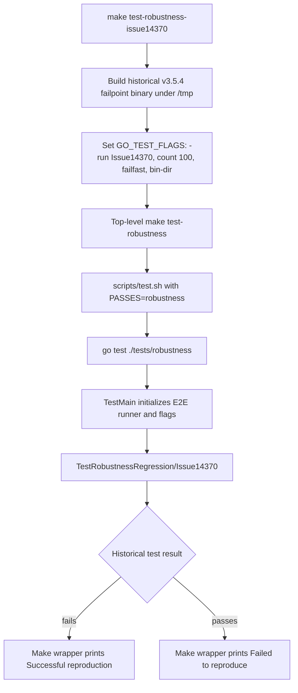
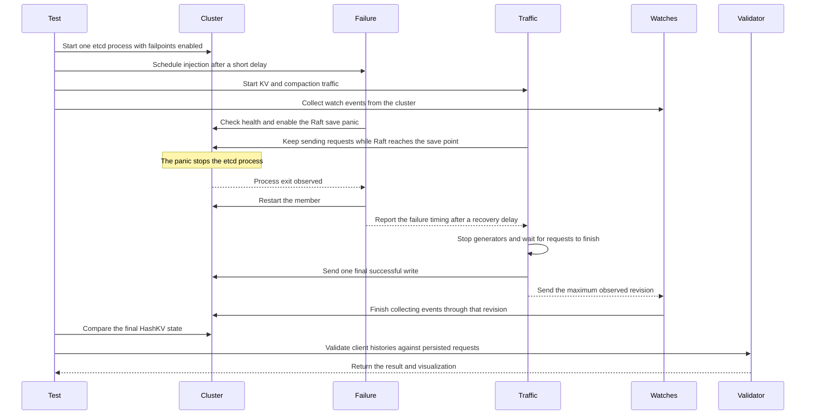

# Issue14370 robustness scenario walkthrough

This walkthrough follows one scenario from Make to the final consistency check. Issue14370 concerns a single-node cluster losing a write after a crash. Its regression scenario generates mixed KV traffic, panics the etcd process immediately before a Raft WAL save, restarts it, then checks the client history against the recovered state.

For local commands and platform setup, see [LOCAL_TESTING.md](LOCAL_TESTING.md). Run the repository scripts in Linux, macOS, or WSL with a Linux Go toolchain.

## The scenario definition

`scenarios.Regression` in [`scenarios/scenarios.go`](scenarios/scenarios.go) creates this `TestScenario`:

| Setting | Value | Effect |
|---|---|---|
| Name | `Issue14370` | Selectable Go subtest name |
| Cluster size | 1 | A single etcd member must recover without Raft peer help |
| Failpoint | `RaftBeforeSavePanic` | Panics at the `raftBeforeSave` failpoint |
| Traffic | `EtcdPutDeleteLease` | Mix of reads, writes, deletes, transactions, and lease operations |
| KV profile | `KeyValueMedium` | 6 clients pinned to a member endpoint and 2 clients using the cluster endpoints; configured rate range 100–200 QPS, burst 1000 |
| Compaction | `CompactionDefault` | Background compaction attempts every 200 ms |
| Watch traffic profile | None | No generated watch workload; the harness still collects watch events from the cluster |

The failpoint is placed in [`server/etcdserver/raft.go`](../../server/etcdserver/raft.go), just before `r.storage.Save(rd.HardState, rd.Entries)`. The failure targets the boundary where Raft entries and hard state are about to be written to the WAL.

## Make and test selection

### One run against the current checkout

The focused command from the repository root is:

```bash
GO_TEST_FLAGS='-v --run=TestRobustnessRegression/Issue14370 --count=1' make test-robustness
```

Build etcd with failpoints enabled first, as described in [LOCAL_TESTING.md](LOCAL_TESTING.md). This command tests the current code and runs the named scenario once. A passing run means the current build survived this injected failure; it does not mean the historical bug has been reproduced.

### Historical bug reproduction target

The dedicated Make target is:

```bash
make test-robustness-issue14370
```

It depends on `/tmp/etcd-v3.5.4-failpoints/bin`. The pattern rule in [`tests/robustness/Makefile`](Makefile) clones the historical `v3.5.4` source into `/tmp`, builds it with failpoints, and supplies that binary using `--bin-dir`. Then it runs the scenario 100 times with `--failfast`.

The target prints **“Successful reproduction”** when `make test-robustness` returns an error, and **“Failed to reproduce”** when it passes. Treat that text as a hint, not proof: any test-run error can lead to “Successful reproduction.” Confirm the logs show a robustness validation failure (for example, `Linearization illegal`) and inspect its report before concluding the old bug reproduced.

### Make-to-Go call path



For the one-run current-checkout command, skip the historical binary prerequisite and `--bin-dir`; the test framework defaults to the repository's `bin` directory. The Go `-run` expression filters the regression subtests by name, so the other regression scenarios are skipped.

## Runtime flow

[`main_test.go`](main_test.go) creates the configured cluster, then `testRobustness` delegates to `runScenario`. The failpoint and traffic execute concurrently so requests are in flight when the crash happens.



The delay before injection lets traffic approach its configured rate. The delay after restart gives the cluster time to recover while traffic continues. Those delays are each one second with ±200 ms jitter.

### What each stage records

1. **Cluster startup:** `e2e.NewEtcdProcessCluster` starts the prebuilt etcd executable. The scenario sets `WithGoFailEnabled(true)`, so the framework checks that the executable exposes failpoints.
2. **Requests:** `traffic.SimulateTraffic` starts eight KV clients (six member-endpoint clients plus two cluster-endpoint clients), records each request and response, and starts compaction on its own loop.
3. **Crash and recovery:** `failpoint.Inject` checks health before and after injection. `goPanicFailpoint.Inject` activates `raftBeforeSave=panic`, waits for the process to exit, and starts it again.
4. **Watch observation:** `runScenario` collects watch events from each endpoint even though this scenario has no generated watch workload. Those observations let the shared validator check watch behavior too.
5. **End conditions:** traffic records a final successful write, the watch collectors finish through the maximum revision, and `CheckEndOfTestHashKV` checks the recovered cluster state.
6. **Validation:** the test loads requests persisted by etcd, then `validate.ValidateAndReturnVisualize` checks whether the observed operations can be explained by a legal etcd history, respecting real-time ordering. If that linearizability check fails, later checks are skipped to keep the report focused.

## Reports and results

By default, report directories are created under `/tmp/TestRobustnessRegression_Issue14370/<timestamp>`. The test saves server data and client reports before validation. A failed test keeps the report; a successful test removes it during finalization. Set `PERSIST_RESULTS=true` to keep successful-run artifacts too.

Useful files in a retained report:

- `history.html` — timeline visualization of the KV operation history, when produced.
- `client-*/operations.json` — recorded KV requests and responses.
- `client-*/watch.json` — observed watch requests and events, when present.
- `server-*` — the member's persisted data directory, including WAL and snapshot data.

The **“Saving robustness test report”** log line gives the exact directory. The README's [failure-analysis section](README.md#analysing-failure) explains how to inspect these artifacts.

## Code reading order

1. [`scenarios/scenarios.go`](scenarios/scenarios.go) — scenario parameters.
2. [`main_test.go`](main_test.go) — test setup, concurrency, validation, and cleanup.
3. [`traffic/traffic.go`](traffic/traffic.go) and [`traffic/etcd.go`](traffic/etcd.go) — generated workload.
4. [`failpoint/gofail.go`](failpoint/gofail.go) — panic setup, process exit, and restart.
5. [`server/etcdserver/raft.go`](../../server/etcdserver/raft.go) — the exact failpoint location.
6. [`validate/validate.go`](validate/validate.go) — history checks.
