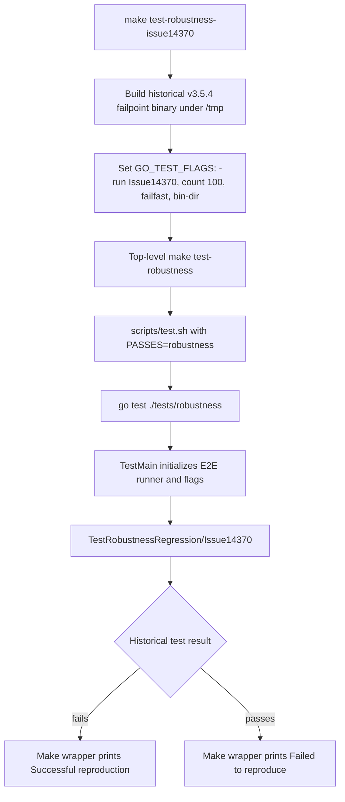
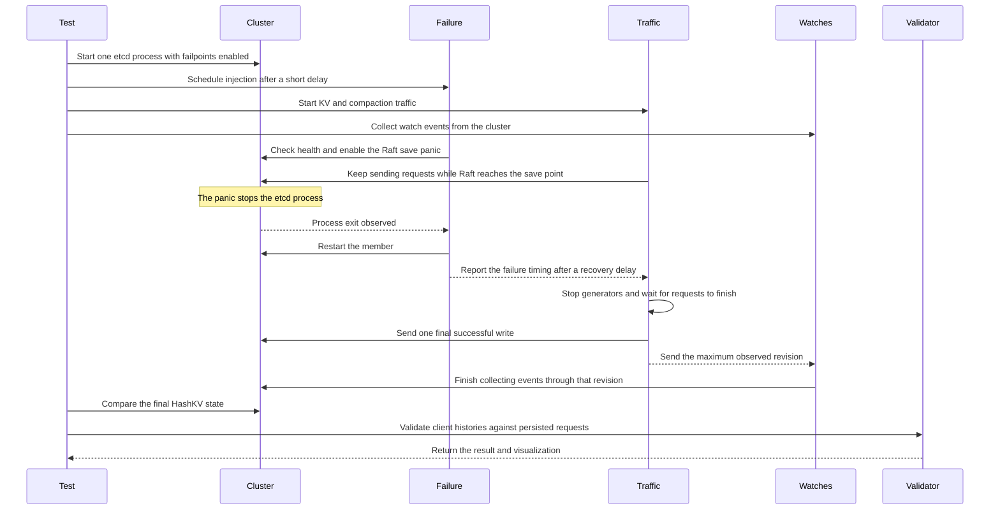
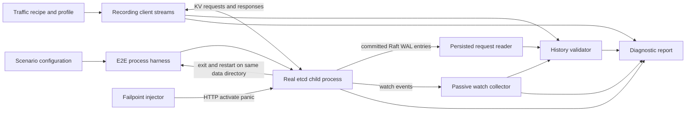

# Issue14370 robustness scenario walkthrough

This walkthrough follows one scenario from Make to the final consistency check. Issue14370 concerns a single-node cluster losing a write after a crash. Its regression scenario generates mixed KV traffic, panics the etcd process immediately before a Raft WAL save, restarts it, then checks the client history against the recovered state.

For local commands and platform setup, see [LOCAL_TESTING.md](LOCAL_TESTING.md). Run the repository scripts in Linux, macOS, or WSL with a Linux Go toolchain.

## The scenario definition

`scenarios.Regression` in [`scenarios/scenarios.go`](scenarios/scenarios.go) creates this `TestScenario`:

| Setting | Value | Effect |
|---|---|---|
| Name | `Issue14370` | Selectable Go subtest name |
| Cluster size | 1 | A single etcd member must recover without Raft peer help |
| Failpoint | `RaftBeforeSavePanic` | Panics at the `raftBeforeSave` failpoint |
| Traffic | `EtcdPutDeleteLease` | Mix of reads, writes, deletes, transactions, and lease operations |
| KV profile | `KeyValueMedium` | 6 clients pinned to a member endpoint and 2 clients using the cluster endpoints; shared rate limiter capped at 200 QPS, minimum 100 QPS required before failure, burst 1000 |
| Compaction | `CompactionDefault` | Background compaction attempts every 200 ms |
| Watch traffic profile | None | No generated watch workload; the harness still collects watch events from the cluster |

The failpoint is placed in [`server/etcdserver/raft.go`](../../server/etcdserver/raft.go), just before `r.storage.Save(rd.HardState, rd.Entries)`. The failure targets the boundary where Raft entries and hard state are about to be written to the WAL.

## Make and test selection

### One run against the current checkout

The focused command from the repository root is:

```bash
GO_TEST_FLAGS='-v --run=TestRobustnessRegression/Issue14370 --count=1' make test-robustness
```

Build etcd with failpoints enabled first, as described in [LOCAL_TESTING.md](LOCAL_TESTING.md). This command tests the current code and runs the named scenario once. A passing run means the current build survived this injected failure; it does not mean the historical bug has been reproduced.

### Historical bug reproduction target

The dedicated Make target is:

```bash
make test-robustness-issue14370
```

It depends on `/tmp/etcd-v3.5.4-failpoints/bin`. The pattern rule in [`tests/robustness/Makefile`](Makefile) clones the historical `v3.5.4` source into `/tmp`, builds it with failpoints, and supplies that binary using `--bin-dir`. Then it runs the scenario 100 times with `--failfast`.

The target prints **“Successful reproduction”** when `make test-robustness` returns an error, and **“Failed to reproduce”** when it passes. Treat that text as a hint, not proof: any test-run error can lead to “Successful reproduction.” Confirm the logs show a robustness validation failure (for example, `Linearization illegal`) and inspect its report before concluding the old bug reproduced.

### Make-to-Go call path



For the one-run current-checkout command, skip the historical binary prerequisite and `--bin-dir`; the test framework defaults to the repository's `bin` directory. The Go `-run` expression filters the regression subtests by name, so the other regression scenarios are skipped.

## Runtime flow

[`main_test.go`](main_test.go) creates the configured cluster, then `testRobustness` delegates to `runScenario`. The failpoint and traffic execute concurrently so requests are in flight when the crash happens.



The delay before injection lets traffic approach its configured rate. The delay after restart gives the cluster time to recover while traffic continues. Those delays are each one second with ±200 ms jitter.

## What each component does

### The E2E process cluster

[`tests/framework/e2e`](../framework/e2e) is the harness that starts real etcd executables for tests. It is not a remote E2E service: this scenario launches `bin/etcd` as a child process on the same machine. The harness gives the member a fresh data directory and local client, peer, metrics, and failpoint ports, starts it, and waits for its ready log lines before returning the cluster to the test.

Before the test body runs, `TestMain` delegates to the E2E runner. It parses test-framework flags such as `--bin-dir` and sets the path to the etcd executable. `TestRobustnessRegression` calls `BeforeTest`, gets the scenario definitions, then starts a cluster for the selected subtest.

Issue14370 sets the cluster size to one and `GoFailEnabled` to true. The one process is the entire cluster and, once bootstrapped, its Raft node is leader. When it exits, the harness starts the same process configuration again against the same data directory. This tests recovery from on-disk WAL and snapshot state; it does not create a new empty member.

### The scenario and traffic profile

The `TestScenario` is just configuration: its name, cluster options, traffic recipe, traffic profile, and failpoint. `TestRobustnessRegression` passes that configuration to `testRobustness`, which starts the cluster and runs `runScenario`.

`EtcdPutDeleteLease` chooses among request types by the weights in [`traffic/etcd.go`](traffic/etcd.go). The workload touches ten generated keys and includes current and stale reads, prefix lists (including streamed and keys-only forms), puts, deletes, transactions, compare-and-set, lease-backed puts, and lease revocations. The weights describe random choices; the loop can temporarily remove delete and revoke choices when its concurrency limit for non-unique writes is reached.

The configured choice weights are:

| Request type | Weight |
|---|---:|
| Get | 15% |
| Prefix list variants | 15% |
| Stale Get | 10% |
| Stale prefix list variants | 10% |
| Put | 20% |
| Delete | 5% |
| Four-operation transaction | 10% |
| Put with lease | 5% |
| Lease revoke | 5% |
| Compare-and-set transaction | 5% |

`KeyValueMedium` creates eight KV clients: six are each given a member endpoint and two are given the cluster endpoint list. With a one-member cluster, these all reach the same etcd process, but they use separate client streams. Before generating traffic, the harness checks that the database is empty, as required by the model's starting state. One rate limiter is shared by the traffic loops. Its configured rate is capped at 200 requests per second, and the test fails the traffic stage if it did not reach at least 100 QPS before the failpoint. A burst of 1000 lets traffic start quickly. Generated requests use a 200 ms request timeout.

The requests go through the normal v3 Go client and gRPC API into the real etcd process. KV operations are handled by etcd's v3 RPC services; writes and transactions use Raft and MVCC storage, while reads can request current or historical revisions. The client wrapper records the API call and result; it does not simulate etcd's responses.

Compaction is another concurrent loop, not a separate server process. Every 200 ms it reads status and asks etcd to compact a randomly chosen revision near the current revision. This puts compaction and its interaction with reads and writes into the same history.

### Recording clients and operation history

Each generated client is a `clientv3` client wrapped by [`client.RecordingClient`](client/client.go). The wrapper timestamps a request's call and return against one shared monotonic clock, records its input and response, and gives each client and write request a unique ID. It serializes KV calls per client so each client's history has an unambiguous sequence, while the eight clients still operate concurrently.

That timing matters during a crash. A write that returned successfully must be ordered before a later operation that began after that return. A failed or interrupted request can be ambiguous: the client may have lost its response even though etcd applied the request. The nondeterministic model keeps both outcomes possible where the recorded result cannot determine which occurred.

### Failpoint control and the etcd process

When etcd is built with GoFail instrumentation, the etcd process exposes a failpoint HTTP endpoint on localhost. The E2E harness discovers available failpoints and calls that endpoint. `failpoint.Inject` checks the member's health, then `goPanicFailpoint.Inject` tells the running process to set `raftBeforeSave=panic`. The code hook is in [`server/etcdserver/raft.go`](../../server/etcdserver/raft.go): Raft reaches it immediately before saving the current hard state and entries to the WAL.

The failpoint does not directly kill the process. The next time execution reaches the hook, the configured panic terminates etcd. The test waits for that child process to exit, then restarts it with the same data directory. Traffic continues during the outage and recovery. The injector checks health again after restart, and the traffic worker waits for the injector's timing report before it stops. This creates a defined before/during/after failure window in the operation history.

### Watch collection

This scenario has no generated watch workload (`Profile.Watch` is nil), but `runScenario` always starts a separate passive watch collector. It opens a watch at every member endpoint from the next revision, records events and progress responses, and requests progress every 100 ms. If compaction cancels a watch, the collector resumes from the reported compact revision. It stops only after it has observed the maximum revision reached by the KV workload.

For a one-member cluster this means one passive watch stream. It lets validation compare what a client could watch against the changes reconstructed from persisted requests, even though watch requests are not part of the generated traffic profile.

### End checks, model, and report

After traffic stops, the test sends one final successful put. This gives the checker a known successful operation after recovery. `CheckEndOfTestHashKV` then compares the end revision and hash across cluster members; here there is one member, so this shared cluster-consistency check is necessarily a one-member comparison.

The harness has two views of the run:

1. **Client view:** calls, responses, timestamps, and passive watch events recorded by the test clients.
2. **Persisted view:** committed normal Raft requests read back from the member's WAL after the run.

`validate.ValidateAndReturnVisualize` uses Porcupine and an etcd model to ask whether there is a legal ordering of the client operations that respects their real-time order and etcd's API behavior. It then replays persisted requests to check watch events and serializable reads. If the linearizability check fails, it skips later checks so they do not obscure the first failure.

The report stores client histories and a copy of the server data directory so a failure can be investigated after the child process has stopped. Failed runs keep their reports by default; set `PERSIST_RESULTS=true` to keep successful-run artifacts as well.

### Component flow



### What each stage records

1. **Cluster startup:** `e2e.NewEtcdProcessCluster` starts the prebuilt etcd executable. The scenario sets `WithGoFailEnabled(true)`, so the framework checks that the executable exposes failpoints.
2. **Requests:** `traffic.SimulateTraffic` starts eight KV clients (six member-endpoint clients plus two cluster-endpoint clients), records each request and response, and starts compaction on its own loop.
3. **Crash and recovery:** `failpoint.Inject` checks health before and after injection. `goPanicFailpoint.Inject` activates `raftBeforeSave=panic`, waits for the process to exit, and starts it again.
4. **Watch observation:** `runScenario` collects watch events from each endpoint even though this scenario has no generated watch workload. Those observations let the shared validator check watch behavior too.
5. **End conditions:** traffic records a final successful write, the watch collectors finish through the maximum revision, and `CheckEndOfTestHashKV` checks the recovered cluster state.
6. **Validation:** the test loads requests persisted by etcd, then `validate.ValidateAndReturnVisualize` checks whether the observed operations can be explained by a legal etcd history, respecting real-time ordering. If that linearizability check fails, later checks are skipped to keep the report focused.

## Reports and results

By default, report directories are created under `/tmp/TestRobustnessRegression_Issue14370/<timestamp>`. The test saves server data and client reports before validation. A failed test keeps the report; a successful test removes it during finalization. Set `PERSIST_RESULTS=true` to keep successful-run artifacts too.

Useful files in a retained report:

- `history.html` — timeline visualization of the KV operation history, when produced.
- `client-*/operations.json` — recorded KV requests and responses.
- `client-*/watch.json` — observed watch requests and events, when present.
- `server-*` — the member's persisted data directory, including WAL and snapshot data.

The **“Saving robustness test report”** log line gives the exact directory. The README's [failure-analysis section](README.md#analysing-failure) explains how to inspect these artifacts.

## Code reading order

1. [`scenarios/scenarios.go`](scenarios/scenarios.go) — scenario parameters.
2. [`main_test.go`](main_test.go) — test setup, concurrency, validation, and cleanup.
3. [`traffic/traffic.go`](traffic/traffic.go) and [`traffic/etcd.go`](traffic/etcd.go) — generated workload.
4. [`failpoint/gofail.go`](failpoint/gofail.go) — panic setup, process exit, and restart.
5. [`server/etcdserver/raft.go`](../../server/etcdserver/raft.go) — the exact failpoint location.
6. [`validate/validate.go`](validate/validate.go) — history checks.
7. [`../framework/e2e/cluster.go`](../framework/e2e/cluster.go) and [`../framework/e2e/etcd_process.go`](../framework/e2e/etcd_process.go) — child process setup, readiness, and restart.
8. [`client/client.go`](client/client.go) and [`client/watch.go`](client/watch.go) — request recording and passive watch capture.
9. [`report/wal.go`](report/wal.go), [`model/non_deterministic.go`](model/non_deterministic.go), and [`validate/operations.go`](validate/operations.go) — recover persisted requests and check possible operation histories.

## Step through the test with Delve

First build `bin/etcd` with failpoints enabled by following [LOCAL_TESTING_DEBIAN.md](LOCAL_TESTING_DEBIAN.md). Then, from the repository root, start Delve from the `tests` Go module:

Alternatively, VS Code has a `Debug robustness: Issue14370` profile in [`.vscode/launch.json`](../../.vscode/launch.json); select it in **Run and Debug** after the failpoint-enabled binary is built.

```bash
cd tests
PERSIST_RESULTS=true RESULTS_DIR="$HOME/etcd-robustness-results" \
dlv test ./robustness -- \
-test.run '^TestRobustnessRegression$/^Issue14370$' -test.count=1 -test.v
```

Delve's `test` command accepts test-binary flags after `--` ([Delve test command docs](https://github.com/go-delve/delve/blob/master/Documentation/usage/dlv_test.md)). At the `(dlv)` prompt, set these breakpoints and start execution:

```text
break TestRobustnessRegression
break runScenario
break go.etcd.io/etcd/tests/v3/robustness/failpoint.Inject
break testRobustness
continue
```

Use `next` to move within a function, `step` to enter a call, and `goroutines` to inspect the traffic and failure workers. These workers run concurrently, so execution will move among goroutines rather than follow one straight line. The main path is `TestRobustnessRegression` → `runScenario` → traffic and failure workers → `CheckEndOfTestHashKV` → `validate.ValidateAndReturnVisualize`.

This Delve session debugs the test process. The Raft panic at [`server/etcdserver/raft.go`](../../server/etcdserver/raft.go) runs in the separate etcd child process, so these breakpoints show the harness enabling the failpoint and observing the child exit; they do not step into the child. To inspect that server code dynamically, you would need to attach a debugger to the etcd child process separately.
