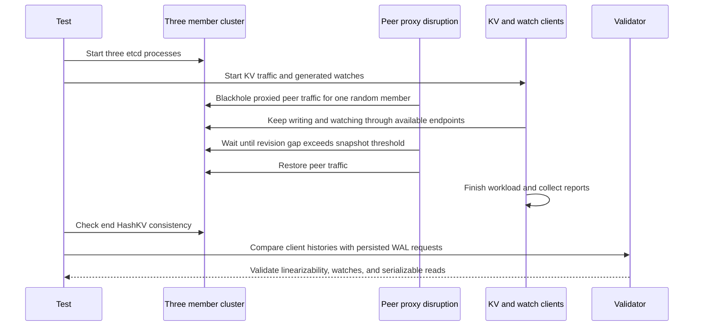

# Issue20221 robustness scenario walkthrough

Issue20221 studies watch behavior when one member falls behind far enough to require a Raft snapshot. It starts the default three-member cluster, writes keys while clients watch revisions around the current point, then blackholes peer proxy traffic for one member until that member is behind by enough entries to require a snapshot transfer. This does not stop every replication path: the proxy code notes that Raft's pipeline traffic can still pass. The proxy is restored before the common end checks run.

For local setup and build instructions, see [LOCAL_TESTING.md](LOCAL_TESTING.md). Run the repository scripts in Linux, macOS, or WSL with a Linux Go toolchain.

## Scenario configuration

`scenarios.Regression` in [`scenarios/scenarios.go`](scenarios/scenarios.go) configures:

| Setting | Value | Effect |
|---|---|---|
| Name | `Issue20221` | Selectable regression subtest |
| Cluster size | 3 (the `NewConfig` default) | A quorum can continue while one member is isolated |
| Disruption | `BlackholeUntilSnapshot` | Drops traffic passing through the peer proxy for one randomly selected member, then waits until it is far enough behind to require snapshot transfer |
| Peer network | Proxy enabled, peer TLS enabled | Lets the harness blackhole peer connections through the test proxy |
| Snapshot settings | `SnapshotCount=10`, catch-up entries `10` | Small thresholds make snapshot transfer practical in the test |
| KV traffic | `EtcdPut`, `KeyValueHigh` | Six member-endpoint and two cluster-endpoint clients; target up to 1000 QPS |
| Watch traffic | Six member-endpoint and two cluster-endpoint clients; revision offsets from -50 to +100 | Exercises watches starting behind or ahead of the current revision |

The snapshot wait is implemented in [`failpoint/network.go`](failpoint/network.go). It polls the affected member's revision and the revision observed through the other members until their gap exceeds `SnapshotCount + SnapshotCatchUpEntries` (20 here). This is intended to put the member behind the leader's compacted log so Raft needs a snapshot to catch it up. The proxy is restored when the wait returns.

## Run only Issue20221

From the repository root:

```bash
GO_TEST_FLAGS='-v --run=TestRobustnessRegression/Issue20221 --count=1' make test-robustness
```

This uses the current checkout's etcd binary. The disruption is injected through the E2E peer proxy, not GoFail instrumentation. The focused VS Code profile is also available as **Debug robustness: Issue20221** in [`.vscode/launch.json`](../../.vscode/launch.json).

## Runtime and final checks

[`main_test.go`](main_test.go) starts the cluster and runs `runScenario`. Traffic and the disruption run concurrently:



The end checks are shared with Issue14370. `CheckEndOfTestHashKV` checks cluster consistency. `ValidateAndReturnVisualize` in [`validate/validate.go`](validate/validate.go) checks whether operations can be linearized and then replays persisted WAL requests to validate watch behavior and serializable reads. The watch-specific rules are in [`validate/watch.go`](validate/watch.go); snapshot/replication behavior itself is exercised by the isolation and recovery path rather than a dedicated snapshot assertion in the final validator.

## Code reading order

1. [`scenarios/scenarios.go`](scenarios/scenarios.go) — Issue20221 settings.
2. [`main_test.go`](main_test.go) — cluster creation, concurrent traffic and disruption, final checks.
3. [`failpoint/network.go`](failpoint/network.go) — selected member, blackhole, revision-gap wait, and restoration.
4. [`tests/framework/e2e/cluster.go`](../framework/e2e/cluster.go) and [`cluster_proxy.go`](../framework/e2e/cluster_proxy.go) — cluster setup and peer proxy implementation. The proxy type is selected by the `cluster_proxy` build tag.
5. [`traffic/traffic.go`](traffic/traffic.go) and [`traffic/etcd.go`](traffic/etcd.go) — KV and watch client setup.
6. [`validate/validate.go`](validate/validate.go) and [`validate/watch.go`](validate/watch.go) — common consistency and watch checks.

## Step through with Delve

From the repository root, start Delve in the `tests` Go module:

```bash
cd tests
PERSIST_RESULTS=true RESULTS_DIR="$HOME/etcd-robustness-results" \
dlv test ./robustness -- \
-test.run '^TestRobustnessRegression$/^Issue20221$' -test.count=1 -test.v
```

At the Delve prompt, set breakpoints around the disruption and final checks:

```text
break TestRobustnessRegression
break runScenario
break go.etcd.io/etcd/tests/v3/robustness/failpoint.Blackhole
break go.etcd.io/etcd/tests/v3/robustness/failpoint.waitTillSnapshot
break go.etcd.io/etcd/tests/v3/robustness/client.CheckEndOfTestHashKV
break go.etcd.io/etcd/tests/v3/robustness/validate.ValidateAndReturnVisualize
continue
```

Use `next` to advance, `step` to enter a call, and `goroutines` to inspect the concurrent traffic and disruption workers. At `waitTillSnapshot`, inspect `clusterRevision`, `blackholedMemberRevision`, and `minEntriesToGuarantee`; the function returns when the gap is larger than the threshold. `Blackhole` then restores both proxy directions in its deferred cleanup. Some Raft pipeline replication may continue during the blackhole. Unlike a GoFail panic, this disruption runs in the test process and is directly debuggable in this Delve session.

For an actual process-level trace, the member selection is random. Set a breakpoint in `blackholePeerNetworkFailpoint.Inject` and inspect `member` to identify the selected process; then inspect the generated test report and logs for the observed revision gap.
